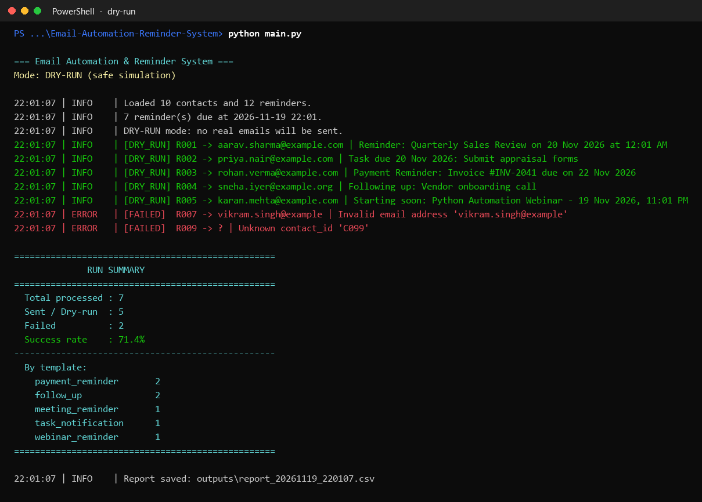
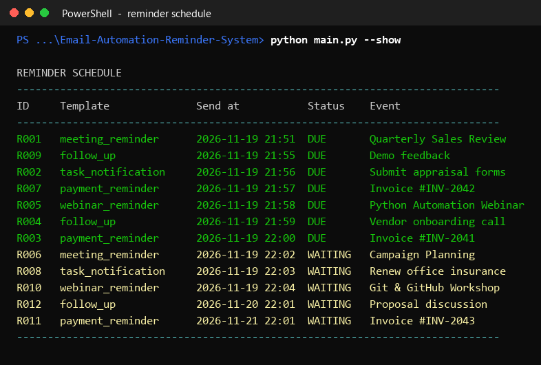
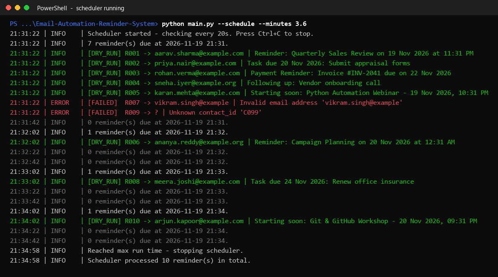
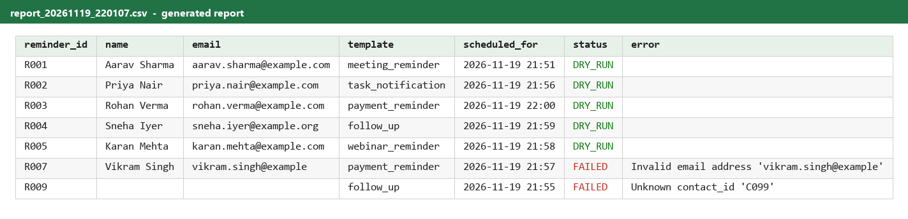
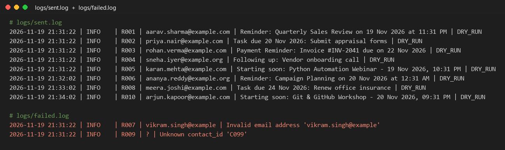
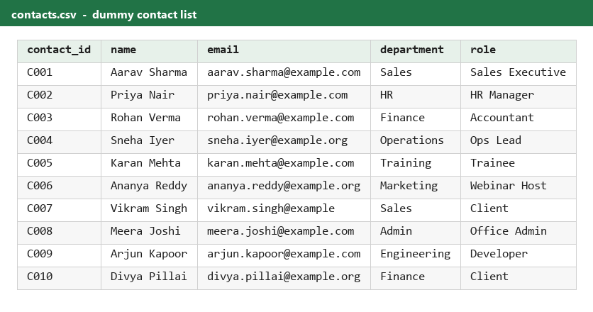
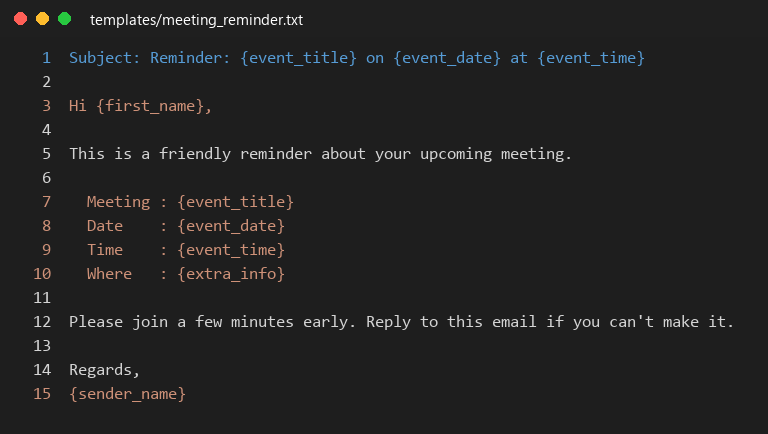
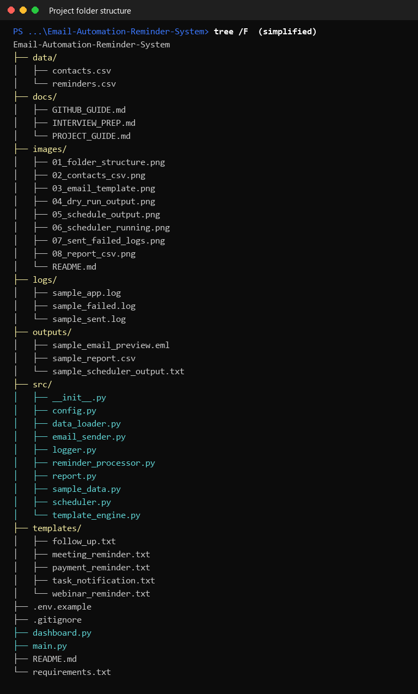

# 📧 Email Automation & Reminder System

A Python tool that reads contacts and reminders from CSV files, personalises email templates, sends reminders automatically when they are due, and records every success and failure in logs and CSV reports.

It has a **dry-run mode**, so the whole workflow can be tested safely without sending a single real email.

   

---

## 📌 Project Overview

Teams send the same kinds of emails over and over: meeting reminders, payment reminders, webinar alerts, follow-ups and task deadlines. This project automates that workflow:

```
contacts.csv ─┐
              ├─► personalise template ─► schedule ─► send (SMTP / dry-run) ─► log status ─► CSV report
reminders.csv ┘
```

## ❗ Problem Statement

Sending reminders by hand is slow and error-prone. People forget to send them, send them late, copy the wrong name, or have no record of who was contacted. A small automated system removes the repeated work and leaves an audit trail.

## 🏢 Industry Relevance

| Team | Use case |
|---|---|
| HR | Interview schedules, appraisal deadlines, onboarding tasks |
| Sales | Client follow-ups after demos and proposals |
| Finance | Invoice and payment-due reminders |
| Training / L&D | Webinar and class reminders with join links |
| Operations / Admin | Task notifications, renewals, compliance deadlines |

The same pattern runs inside tools like Mailchimp, HubSpot and Zoho. This project builds the core logic from scratch in Python.

## ✨ Features

- 📂 Reads contacts and reminders from CSV with **pandas** and checks required columns
- ✉️ **5 reusable templates**: meeting, payment, webinar, follow-up, task
- 👤 **Personalisation** with placeholders (`{first_name}`, `{event_date}` …)
- ⏰ **Scheduler** (`schedule` library) that sends each reminder when its `send_at` time arrives
- 🧪 **Dry-run mode** by default: emails are saved as `.eml` previews instead of being sent
- 🔐 **Secure credentials** in environment variables / `.env`, never in code
- 🛡️ **Validation & error handling**: invalid emails and unknown contacts are marked FAILED without stopping the batch
- 📝 **Logging** to `app.log`, `sent.log`, `failed.log`
- 📊 **CSV reports** per run plus a running `report_history.csv`
- 📈 Optional **Streamlit dashboard**

## 🛠️ Tech Stack

| Purpose | Tool |
|---|---|
| Language | Python 3.9+ |
| Data handling | pandas, CSV |
| Email | smtplib, email.message, ssl (STARTTLS) |
| Scheduling | schedule, datetime |
| Config / secrets | python-dotenv, environment variables |
| Logging | logging |
| Dashboard (optional) | Streamlit |

## 📁 Folder Structure

```
Email-Automation-Reminder-System/
│
├── data/                    # Input CSVs (dummy data only)
│   ├── contacts.csv
│   └── reminders.csv
├── templates/               # Email templates (first line = Subject)
│   ├── meeting_reminder.txt
│   ├── payment_reminder.txt
│   ├── webinar_reminder.txt
│   ├── follow_up.txt
│   └── task_notification.txt
├── src/                     # Application code
│   ├── config.py            # Paths + settings from environment
│   ├── logger.py            # Terminal + file logging
│   ├── data_loader.py       # Read/validate CSVs, merge contacts
│   ├── template_engine.py   # Load templates, fill placeholders
│   ├── email_sender.py      # SMTP sending / dry-run previews
│   ├── reminder_processor.py# Core workflow
│   ├── scheduler.py         # Continuous scheduling loop
│   ├── report.py            # CSV report + summary
│   └── sample_data.py       # Dummy data generator
├── outputs/                 # Generated reports (+ dry-run .eml previews)
├── logs/                    # app.log, sent.log, failed.log
├── images/                  # Screenshots for this README
├── docs/                    # Project guide, GitHub guide, interview prep
├── main.py                  # Command-line entry point
├── dashboard.py             # Optional Streamlit dashboard
├── requirements.txt
├── .env.example             # Template for secrets (real .env is ignored)
├── .gitignore
└── README.md
```

## ⚙️ Setup

**Windows (PowerShell)**
```powershell
git clone https://github.com/<your-username>/Email-Automation-Reminder-System.git
cd Email-Automation-Reminder-System
python -m venv venv
venv\Scripts\activate
pip install -r requirements.txt
```

**Mac / Linux**
```bash
git clone https://github.com/<your-username>/Email-Automation-Reminder-System.git
cd Email-Automation-Reminder-System
python3 -m venv venv
source venv/bin/activate
pip install -r requirements.txt
```

## 🔐 Environment Variables (only needed for real sending)

1. Copy the example file: `copy .env.example .env` (Windows) or `cp .env.example .env` (Mac/Linux)
2. Turn on 2-Step Verification for your Google account, then create an **App Password** (Google Account → Security → App passwords).
3. Put your Gmail address and the 16-character app password in `.env`.

`.env` is listed in `.gitignore`, so it is never uploaded.

## ▶️ How to Run

```bash
python main.py --generate-sample   # create fresh dummy data (times relative to now)
python main.py --show              # view the reminder schedule
python main.py                     # dry-run: process reminders that are due now
python main.py --all               # dry-run: process every reminder immediately
python main.py --schedule          # dry-run: keep running, send each reminder when due (Ctrl+C to stop)
python main.py --schedule --minutes 5   # same, auto-stop after 5 minutes
python main.py --live              # REAL emails via SMTP (asks for confirmation)
streamlit run dashboard.py         # optional dashboard (pip install streamlit)
```

## 📤 Sample Output

```
=== Email Automation & Reminder System ===
Mode: DRY-RUN (safe simulation)

21:31:04 | INFO    | Loaded 10 contacts and 12 reminders.
21:31:04 | INFO    | 7 reminder(s) due at 2026-11-19 21:31.
21:31:04 | INFO    | DRY-RUN mode: no real emails will be sent.
21:31:04 | INFO    | [DRY_RUN] R001 -> aarav.sharma@example.com | Reminder: Quarterly Sales Review on 19 Nov 2026 at 11:31 PM
21:31:04 | INFO    | [DRY_RUN] R002 -> priya.nair@example.com | Task due 20 Nov 2026: Submit appraisal forms
21:31:04 | INFO    | [DRY_RUN] R003 -> rohan.verma@example.com | Payment Reminder: Invoice #INV-2041 due on 22 Nov 2026
21:31:04 | ERROR   | [FAILED]  R007 -> vikram.singh@example | Invalid email address 'vikram.singh@example'
21:31:04 | ERROR   | [FAILED]  R009 -> ? | Unknown contact_id 'C099'

==================================================
              RUN SUMMARY
==================================================
  Total processed : 7
  Sent / Dry-run  : 5
  Failed          : 2
  Success rate    : 71.4%
==================================================
```

**Report CSV** (`outputs/report_YYYYMMDD_HHMMSS.csv`):

| reminder_id | name | email | template | status | error |
|---|---|---|---|---|---|
| R001 | Aarav Sharma | aarav.sharma@example.com | meeting_reminder | DRY_RUN | |
| R007 | Vikram Singh | vikram.singh@example | payment_reminder | FAILED | Invalid email address |
| R009 | | | follow_up | FAILED | Unknown contact_id 'C099' |

The sample data includes two deliberate failures to show the error handling.

## 🖼️ Screenshots

**Dry-run: due reminders processed, bad records caught**


**Reminder schedule: DUE vs WAITING**


**Scheduler running: each WAITING reminder is sent at its scheduled minute**


**Generated CSV report**


**Sent / failed logs**


| Contacts CSV | Email template |
|---|---|
|  |  |

<details><summary>Project folder structure</summary>


</details>

## 🎓 Learning Outcomes

- Reading, validating and joining tabular data with pandas
- Building and sending MIME emails with `smtplib` + `email.message` over TLS
- Template-based personalisation
- Time-based job scheduling
- Handling secrets safely with environment variables
- Defensive error handling so one bad record doesn't stop the batch
- Structured logging and automated reporting
- Organising a modular, GitHub-ready Python project

## 🚀 Future Improvements

- HTML emails and attachments
- Store reminders in SQLite instead of CSV
- Recurring reminders (daily / weekly)
- Retry failed emails automatically
- Deploy with cron / Windows Task Scheduler / GitHub Actions

## 📚 More Docs

- [Project Guide](docs/PROJECT_GUIDE.md): concepts, architecture, implementation plan, simulation
- [GitHub & Proof Guide](docs/GITHUB_GUIDE.md): upload steps, 6-day commit plan, screenshots
- [Interview Prep](docs/INTERVIEW_PREP.md)

---
⚠️ All contacts in this repo are fictional and use the reserved `example.com` / `example.org` domains.
